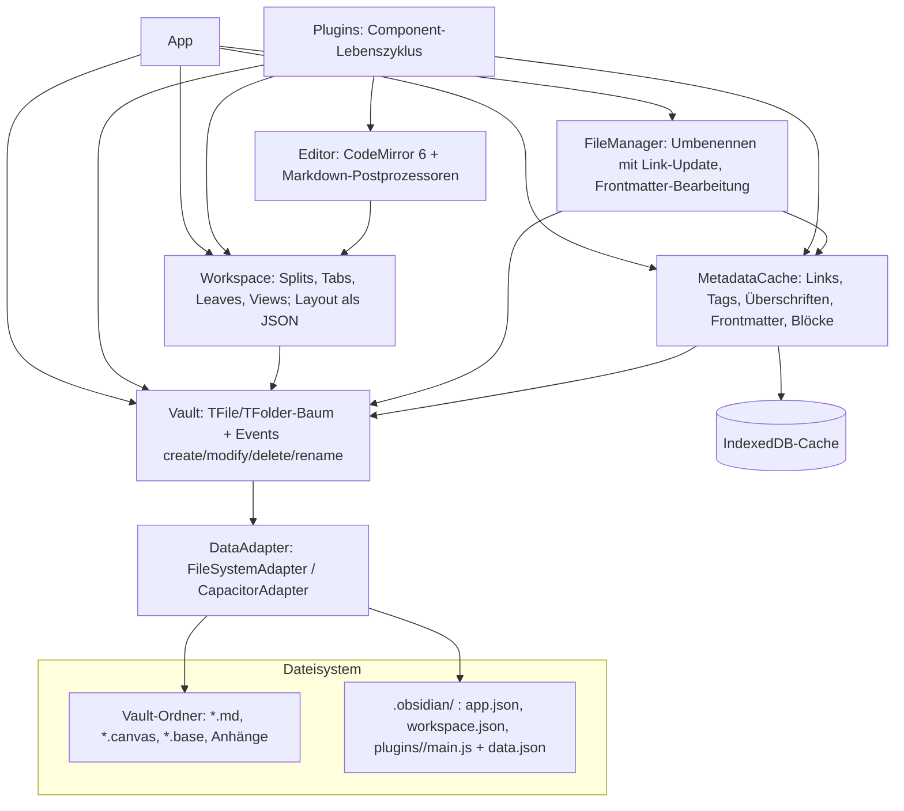

# Obsidian – Architekturanalyse (Reverse Engineering aus öffentlichen Quellen)

**Untersuchter Stand (9. Nov. 2026):** Obsidian Desktop 1.15.0 (Beta 1.15.1), öffentliche API `obsidian` 1.14.4.
**Wichtige Abgrenzung:** Obsidian ist im Gegensatz zu SpiderFoot **proprietär** (Dynalist Inc.).
Der Programmcode der App (`obsidian-<version>.asar`) wurde **nicht** entpackt, dekompiliert oder
deobfuskiert. Grundlage sind ausschließlich offen veröffentlichte Materialien:

| Quelle | Lizenz | Inhalt |
|---|---|---|
| `obsidianmd/obsidian-api` (`obsidian.d.ts`, `canvas.d.ts`, `publish.d.ts`, CHANGELOG) | MIT | vollständige öffentliche Plugin-API, ca. 12 100 Zeilen TypeScript-Typen |
| `obsidianmd/obsidian-sample-plugin` | MIT | Referenz-Plugin, Build- und Release-Ablauf |
| `obsidianmd/jsoncanvas` | MIT | offenes Canvas-Dateiformat (Spec 1.0) |
| `obsidianmd/obsidian-releases` | – | Update-Manifest, Plugin-/Theme-Verzeichnis, Review-Regeln |
| `obsidianmd/obsidian-help` | – | offizielle Hilfe (Speicherung, Sync, Plugin-Sicherheit, URI, CLI, Bases) |

Alle Aussagen zum Inneren der App sind daher **aus der API und dem beobachtbaren Verhalten
abgeleitet** (Black-Box-Rekonstruktion), nicht aus dem Quellcode gelesen.

---

## 1. Überblick

| Aspekt | Befund |
|---|---|
| Laufzeit | Desktop: Electron (Chromium + Node.js); Mobil: Capacitor (WebView). Belegt durch die zwei Speicher-Adapter `FileSystemAdapter` und `CapacitorAdapter`. |
| Editor | CodeMirror 6 (`@codemirror/state`, `@codemirror/view` als Peer-Dependencies der API) |
| Daten | Normale Markdown-Dateien in einem Ordner („Vault“); keine proprietäre Datenbank als Wahrheitsquelle |
| Index | Metadaten-Cache in IndexedDB, jederzeit aus den Dateien neu aufbaubar |
| Erweiterbarkeit | Plugin-API (103 Klassen, 112 Interfaces, 47 Funktionen, 30 Typen in `obsidian.d.ts`) |
| Ökosystem | 10 181 Community-Plugins und 1 000 Themes im offiziellen Verzeichnis (Stand 9. Nov. 2026) |
| Offene Formate | Markdown + YAML-Frontmatter, JSON Canvas (`.canvas`), Bases (`.base`, YAML) |
| Bezahl-Dienste | Sync (E2E-verschlüsselt), Publish; zusätzlich Headless-Client und CLI |

## 2. Schichtenmodell (rekonstruiert)



### 2.1 `App` – zentrales Objekt
`App` bündelt `vault`, `metadataCache`, `fileManager`, `workspace`, `keymap`, `scope`,
`secretStorage` sowie `loadLocalStorage/saveLocalStorage` (vault-bezogener Browser-Speicher).
Plugins erhalten genau diese eine Referenz – es gibt **keine Rechtetrennung** zwischen Plugins.

### 2.2 Speicherschicht: `DataAdapter` → `Vault`
* `DataAdapter` ist eine dünne Dateisystem-Abstraktion mit **pfadbasierten** Operationen (`read`, `write`,
  `append`, `process`, `rename`, `trashSystem`/`trashLocal`, `stat`, `list`). Die zwei Implementierungen
  kapseln Node-`fs` (Desktop) bzw. Capacitor-Filesystem (Mobil).
* `Vault` hält darüber ein **In-Memory-Abbild des Ordnerbaums** (`TAbstractFile` → `TFile`/`TFolder`)
  und feuert Ereignisse `create`, `modify`, `delete`, `rename(file, oldPath)`.
* `cachedRead()` vs. `read()`: die App hält Dateiinhalte im Speicher; `process(file, fn)` ist eine
  **atomare Read-Modify-Write-Operation** (Schutz gegen verlorene Updates bei parallelen Änderungen).
* Externe Änderungen (anderer Editor, Git, Dropbox) werden laut Doku automatisch erkannt → ein
  Dateisystem-Watcher gleicht das Abbild ab. Dateien sind die einzige Wahrheitsquelle.

### 2.3 Indexschicht: `MetadataCache`
Pro Datei wird ein `CachedMetadata`-Objekt erzeugt mit: `links`, `embeds`, `tags`, `headings`,
`sections`, `listItems` (inkl. Aufgabenstatus), `blocks` (`^block-id`), `footnotes`,
`referenceLinks`, `frontmatter` + `frontmatterLinks` – jeweils mit **Positionsangaben** (Zeile/Spalte/Offset).

* Globale Linktabellen: `resolvedLinks[quelle][ziel] = anzahl` und `unresolvedLinks` – daraus entstehen
  **Backlinks, Graph-Ansicht und „unverlinkte Erwähnungen“**, ohne dass jede Datei erneut geparst wird.
* Linkauflösung über `getFirstLinkpathDest(linkpath, sourcePath)`: kürzester eindeutiger Pfad,
  relativ zur Quelldatei.
* Ereignisse `changed` (pro Datei, nach dem Parsen), `resolve` und `resolved` (alle Links aufgelöst).
  Das Parsen läuft asynchron (laut Community-Wissen in Web Workern – aus der API nicht belegbar).
* Persistenz in IndexedDB, damit der Start bei großen Vaults schnell bleibt; „Cache neu aufbauen“
  verwirft ihn und liest alle Dateien neu.

### 2.4 Semantische Schreiboperationen: `FileManager`
`renameFile()` aktualisiert **automatisch alle eingehenden Links** im Vault (nutzt `resolvedLinks`),
`processFrontMatter()` liest/ändert YAML-Frontmatter strukturiert, `generateMarkdownLink()` erzeugt
Links gemäß Nutzereinstellung (Wikilink oder Markdown, relativ/absolut), `trashFile()` respektiert die
Papierkorb-Einstellung.

### 2.5 Oberfläche: `Workspace`
Baumstruktur aus `WorkspaceRoot`/`WorkspaceSplit`/`WorkspaceTabs`/`WorkspaceLeaf`, dazu linke/rechte
Seitenleiste (`WorkspaceSidedock`), Pop-out-Fenster (`WorkspaceWindow`) und mobile Drawer.
Jeder Tab („Leaf“) enthält eine `View` (Markdown, Canvas, Graph, Bases oder Plugin-View).
`getLayout()`/`changeLayout()` serialisieren das gesamte Layout als JSON → `.obsidian/workspace.json`,
gespeichert mit Entprellung (`requestSaveLayout: Debouncer`). Seit 1.7.2 werden Tabs **verzögert
geladen** („deferred views“), um den Start zu beschleunigen.

### 2.6 Editor und Rendering
* Bearbeitung: CodeMirror 6; Plugins hängen sich mit `registerEditorExtension()` direkt ein
  (StateFields, ViewPlugins, Decorations → so entstehen „Live Preview“-Effekte).
* Lesemodus: Markdown → HTML, danach Kette von **Postprozessoren**
  (`registerMarkdownPostProcessor`, `registerMarkdownCodeBlockProcessor` für eigene Codeblock-Sprachen
  wie `dataview`, `mermaid`).
* Wiederverwendung: `MarkdownRenderer.render()` erlaubt Plugins, beliebigen Markdown-Text zu rendern.

### 2.7 Plugin-Modell
* Basisklasse `Component` mit `onload/onunload` und **automatischer Ressourcenfreigabe**:
  alles über `registerEvent`, `registerDomEvent`, `registerInterval`, `register(cb)` und `addChild`
  wird beim Entladen abgebaut. Das ist der Kern der Stabilität beim Deaktivieren von Plugins.
* `Plugin` erweitert das um Erweiterungspunkte: Befehle (`addCommand`), Ribbon-Icons, Statusleiste,
  Einstellungen (`addSettingTab`), eigene Views/Dateiendungen (`registerView`, `registerExtensions`),
  Editor-Vorschläge, `obsidian://`-Handler, **Bases-Views** und seit 1.12.2 **CLI-Befehle**
  (`registerCliHandler`).
* Persistenz pro Plugin: `loadData/saveData` → `.obsidian/plugins/<id>/data.json`;
  Geheimnisse seit neueren Versionen über `app.secretStorage` (`setSecret/getSecret/listSecrets`)
  statt Klartext in `data.json`.
* Verteilung: Eintrag in `community-plugins.json` (id, name, author, description, GitHub-`repo`).
  Die App lädt `manifest.json`, `main.js`, `styles.css` aus dem **GitHub-Release** mit der Version als Tag.
  `manifest.json` deklariert `id`, `version`, `minAppVersion`, `isDesktopOnly`.

## 3. Dateiformate und Schnittstellen

| Format/Schnittstelle | Aufbau |
|---|---|
| Notiz `.md` | CommonMark + GFM + Obsidian-Erweiterungen: `[[Wikilink#Überschrift^block\|Alias]]`, `![[Einbettung]]`, `#tag`, Callouts `> [!note]`, `%%Kommentar%%`, `==Markierung==`, YAML-Frontmatter („Properties“) |
| Canvas `.canvas` | **JSON Canvas 1.0** (offene Spec): `nodes[]` (`text`/`file`/`link`/`group`, mit x/y/width/height/color) und `edges[]` (`fromNode`/`toNode`, Seiten, Pfeilenden, Label) |
| Bases `.base` | YAML: `filters`, `formulas`, `properties`, `summaries`, `views` – eine Abfragesprache über Frontmatter- und Dateieigenschaften (datenbankartige Tabellen/Karten ohne separate DB) |
| `.obsidian/` | offiziell dokumentiert: `workspace.json`, `workspaces.json`, `appearance.json`, `plugins/<id>/…`, `themes/`, `snippets/`; zusätzlich in Vaults beobachtbar, aber nicht dokumentiert: `app.json`, `hotkeys.json`, `core-plugins.json`, `community-plugins.json`. Ordnername konfigurierbar (Profile) |
| Globale Einstellungen | Windows `%APPDATA%\Obsidian\`, Linux `~/.config/obsidian/`, macOS `~/Library/Application Support/obsidian` |
| URI | `obsidian://open`, `new`, `daily`, `unique`, `search`, … mit `vault`, `file`, `path`, `content`, `append`, `heading` |
| CLI (ab Installer 1.12.7) | `obsidian <befehl>` steuert die **laufende** App (inkl. Entwicklerbefehlen); Plugins können Befehle ergänzen |
| Headless (Beta) | eigenständiger Client für Sync/Publish ohne Desktop-App (Backups, Server, Agenten) |

## 4. Update- und Vertriebsmechanismus

`desktop-releases.json` im öffentlichen Repo enthält `latestVersion`, `minimumVersion`, eine
`downloadUrl` auf `obsidian-<v>.asar.gz`, einen SHA-256-`hash` (Base64) und eine **Signatur**.
Daraus folgt ein **zweistufiges Update-Modell**:

1. **Installer** (Electron-Hülle, plattformspezifisch) – ändert sich selten; manche Funktionen (z. B. CLI)
   verlangen eine Mindestversion des Installers.
2. **App-Paket** (`.asar`) – wird von der App selbst heruntergeladen, Hash und Signatur werden geprüft,
   und beim nächsten Start geladen. `minimumVersion` legt fest, ab welcher Installer-Version das geht.

Beta-Kanal („Insider“) über einen separaten Eintrag `beta`.

## 5. Sicherheitsbewertung

| Thema | Befund |
|---|---|
| Lokale Daten | **Nicht verschlüsselt** – Vault sind Klartextdateien; Schutz hängt am Betriebssystem/Datenträger. |
| Plugins | Laufen mit **vollen Rechten der App** (Dateien, Netzwerk, Node.js auf Desktop, Prozessstart). Laut offizieller Doku ist keine Rechtebegrenzung möglich. |
| Restricted Mode | Standardmäßig an: Community-Plugins werden erst nach bewusster Freischaltung ausgeführt. |
| Plugin-Prüfung | Automatischer Scan jeder Version + manuelle Reviews bei populären/gemeldeten Plugins; dennoch Lieferkettenrisiko, da Code direkt aus GitHub-Releases kommt. |
| Geheimnisse | `SecretStorage` als zentrale Ablage; ältere Plugins speichern Tokens oft noch in `data.json` (Klartext, wird mit Vault synchronisiert). |
| Sync | Standard: Ende-zu-Ende-Verschlüsselung, scrypt (mit Salt) als Schlüsselableitung, AES-256-GCM; alternativ „Standard-Verschlüsselung“ mit serverseitig verwaltetem Schlüssel. Laut Hersteller extern auditiert. |
| Updates | Signiertes und gehashtes App-Paket. |
| URI-Handler | `obsidian://new … &content=` kann Inhalte in Notizen schreiben – Webseiten können solche Links anbieten; Bestätigungsverhalten hängt von der App-Version ab. |
| Konfiguration im Vault | `.obsidian/plugins/*/main.js` liegt im Vault → wer einen fremden Vault öffnet und Plugins aktiviert, führt fremden Code aus. |

## 6. Architekturprinzipien – was Obsidian gut macht

1. **Dateien sind die Wahrheit, alles andere ist Cache.** Index, Graph, Backlinks und Bases sind
   rekonstruierbar; Datenverlust durch Index-Fehler ist ausgeschlossen.
2. **Ereignisgetriebene Schichten** (`Vault` → `MetadataCache` → Views), alle über das gleiche
   `Events`/`EventRef`-Muster.
3. **Positionsgenaue Metadaten**: jeder Link, jede Überschrift, jeder Block hat exakte Offsets → stabile
   Sprungziele (`#Überschrift`, `^block-id`).
4. **Link-Integrität beim Umbenennen** über die globale Link-Tabelle.
5. **Lebenszyklus mit automatischer Aufräumlogik** (`Component`) – Grundlage für ein großes,
   austauschbares Plugin-Ökosystem.
6. **Offene, einfache Formate** (Markdown, JSON Canvas, YAML-Bases) → kein Lock-in.

Schwächen: keine Plugin-Sandbox, keine lokale Verschlüsselung, Single-User-Modell (Teams nur über
Sync-Freigaben), keine eingebaute Versionierung außerhalb von Sync/Dateiwiederherstellung.

## 7. Übertragbare Muster für EagleEye

| Obsidian-Muster | Nutzen für EagleEye |
|---|---|
| Datei/Originalbeleg als Wahrheitsquelle, Index rekonstruierbar | Passt zu EagleEyes Trennung Originaltext ↔ Interpretation: Suchindex/Graph immer aus gespeicherten Belegen neu aufbaubar machen |
| Block-IDs `^id` + Positions-Offsets | Stabile Originalanker in Dokumenten (Zeichen-Offset + Hash), wie bei EagleEyes „Originalfundstellen“ |
| `resolvedLinks`/`unresolvedLinks` | Ungeklärte Verweise zwischen Fallquellen explizit als „unaufgelöst“ führen statt verwerfen |
| JSON Canvas | Offenes Austauschformat für Ermittlungsgraphen/Mindmaps; Export des EagleEye-Netzwerkgraphen als `.canvas` |
| Bases (deklarative Abfragen über Properties) | Fallansichten als gespeicherte, deklarative Filter statt fest programmierter Listen |
| `Component`-Lebenszyklus | Für Konnektoren/Panels: Ressourcen zentral registrieren und beim Entladen sicher freigeben |
| Signiertes App-Paket + Mindest-Installer-Version | Vorlage für einen verifizierten Updater der Windows-Installation |
| `obsidian://`-Handler | Deep-Links in Fälle/Belege (z. B. aus Berichten) – aber nur lesend oder mit Bestätigung |

**Nicht übernehmen:** Ausführung fremder Plugins mit vollen Rechten; unverschlüsselte lokale Ablage
sensibler Falldaten; Konfiguration mit ausführbarem Code innerhalb des Datenordners.

## 8. Nachprüfen

```bash
git clone https://github.com/obsidianmd/obsidian-api        # obsidian.d.ts, CHANGELOG.md
git clone https://github.com/obsidianmd/obsidian-releases   # desktop-releases.json, community-plugins.json
git clone https://github.com/obsidianmd/jsoncanvas          # spec/1.0.md
git clone https://github.com/obsidianmd/obsidian-help       # en/Files and folders/How Obsidian stores data.md
grep -n "export declare class Vault" -A200 obsidian-api/obsidian.d.ts
```
