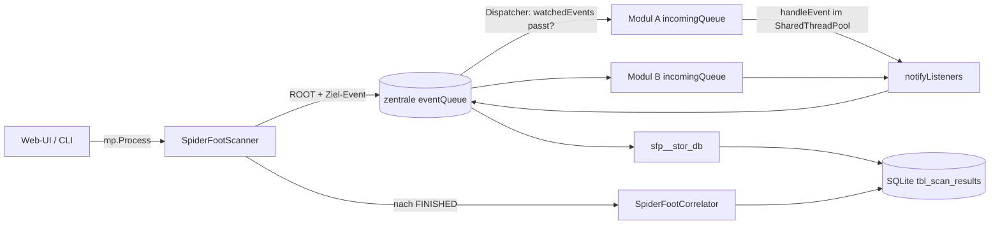

# SpiderFoot – Reverse Engineering / Architekturanalyse

**Untersuchter Stand:** `smicallef/spiderfoot`, Version 4.0.0, Commit `0f815a2` (5. Nov. 2023), MIT-Lizenz.
**Methode:** Statische Quellcodeanalyse (kein Ausführen der Software, keine Scans gegen Ziele).
**Zweck:** Funktionsweise verstehen, Stärken/Schwächen bewerten und übertragbare Muster für EagleEye ableiten.
In EagleEye ist SpiderFoot bereits als `isolated_collector_reference` registriert
(`src/eagleeye/application/build213/service.py:84`).

---

## 1. Überblick in Zahlen

| Bereich | Umfang |
|---|---|
| Kerncode (`sf*.py`, `spiderfoot/*.py`) | ca. 12 100 Zeilen Python |
| Datenmodule (`modules/sfp_*.py`) | 231 Sammelmodule + 2 Speichermodule (`sfp__stor_db`, `sfp__stor_stdout`) |
| Module mit API-Key-Bedarf (Flag `apikey`) | 79 |
| Eventtypen (`tbl_event_types`) | 165 (51 ENTITY, 5 SUBENTITY, 79 DESCRIPTOR, 29 DATA, 1 INTERNAL) |
| Korrelationsregeln (`correlations/*.yaml`) | 37 (9 HIGH, 10 MEDIUM, 6 LOW, 12 INFO) |
| Zieltypen (`SpiderFootTarget._validTypes`) | 11: IP_ADDRESS, IPV6_ADDRESS, NETBLOCK_OWNER, NETBLOCKV6_OWNER, INTERNET_NAME, EMAILADDR, HUMAN_NAME, BGP_AS_OWNER, PHONE_NUMBER, USERNAME, BITCOIN_ADDRESS |
| Persistenz | eine SQLite-Datei (WAL-Modus) |
| Oberflächen | Web-UI (CherryPy + Mako), CLI-Scanner (`sf.py`), interaktive CLI-Shell (`sfcli.py`, spricht die Web-API an) |

## 2. Komponenten

```
sf.py            Einstieg: startet Web-UI ODER führt einen CLI-Scan aus; lädt Module & Regeln
sfwebui.py       CherryPy-Controller (≈40 Endpunkte, HTML + JSON)
sfcli.py         interaktive Shell, nutzt die JSON-Endpunkte der Web-UI
sfscan.py        SpiderFootScanner: Scan-Lebenszyklus + zentraler Event-Dispatcher
sflib.py         "SpiderFoot"-Hilfsobjekt: HTTP (fetchUrl), DNS, Cache, Config-(De)Serialisierung
spiderfoot/
  plugin.py      Basisklasse SpiderFootPlugin (alle Module erben)
  event.py       SpiderFootEvent (Datenpunkt + Herkunftskette)
  target.py      SpiderFootTarget (Ziel + Aliase)
  db.py          SpiderFootDb (Schema, alle SQL-Zugriffe)
  correlation.py SpiderFootCorrelator (YAML-Regel-Engine)
  threadpool.py  SpiderFootThreadPool (gemeinsamer Worker-Pool)
  helpers.py     Parser/Extraktoren (E-Mails, URLs, Hashes, Graph-Export …)
  logger.py      Logging über multiprocessing-Queue in die DB
modules/         Plugins sfp_<name>.py
correlations/    YAML-Regeln
```

## 3. Kernprinzip: ereignisgetriebener Publish/Subscribe-Graph

SpiderFoot hat **keinen fest programmierten Ablauf**. Jedes Modul deklariert nur:

* `watchedEvents()` – welche Eventtypen es konsumiert (oder `*`),
* `producedEvents()` – welche Eventtypen es erzeugen kann,
* `handleEvent(event)` – Verarbeitung eines Events, ruft für Funde `notifyListeners(neuesEvent)` auf.

Daraus entsteht zur Laufzeit ein **sich selbst ausbreitender Ermittlungsgraph**:
Ziel `example.com` → DNS-Modul erzeugt `IP_ADDRESS` → Reputations-Module reagieren auf `IP_ADDRESS` →
erzeugen `MALICIOUS_IPADDR`, `NETBLOCK_OWNER` … → weitere Module reagieren usw.



### 3.1 Scan-Lebenszyklus (`sfscan.py`)

1. **Prozessstart:** Web-UI/CLI startet pro Scan einen eigenen Betriebssystemprozess
   (`multiprocessing.Process(target=startSpiderFootScanner)`, `sfwebui.py:840`). Logs gehen über eine
   `loggingQueue` zurück an den Hauptprozess.
2. **Initialisierung:** Scan-Datensatz anlegen, komplette Konfiguration als Snapshot in `tbl_scan_config`
   speichern (Reproduzierbarkeit), Proxy (SOCKS4/5, HTTP, TOR→`socks5h`) und DNS-Server setzen,
   Public-Suffix-Liste laden (gecacht).
3. **Module laden:** dynamischer Import `__import__('modules.' + modName)`; jede Modulinstanz bekommt
   eine **Kopie** von Moduloptionen + globalen Optionen (`_`-Präfix = global, `__`-Präfix = intern).
   Module dürfen das Ziel über `enrichTarget()` um Aliase erweitern.
4. **Sortierung nach `_priority`** (kleiner = früher; Speichermodul hat 0, fast alle anderen 1).
5. **Seed-Events:** Pseudo-Modul „SpiderFoot UI“ sendet `ROOT` und danach das Ziel-Event
   (Sonderfall: `INTERNET_NAME`, das eine registrierbare Domain ist, wird zusätzlich als `DOMAIN_NAME` gesendet).
6. **Dispatcher-Schleife (`waitForThreads`)**: holt Events aus der zentralen Queue und kopiert sie
   (`deepcopy`) in die Eingangsqueue jedes interessierten Moduls. Alle 10 Iterationen wird in der DB
   geprüft, ob `ABORT-REQUESTED` gesetzt wurde (so funktioniert „Stop“ aus der Web-UI).
7. **Ende-Erkennung:** Wenn Queue leer und kein Modul mehr arbeitet, wird jedem Modul das Sentinel
   `'FINISHED'` geschickt (→ `finish()`-Hook für Batch-Module). Das geschieht bis zu 3 Mal
   (`final_passes`), weil `finish()` neue Events erzeugen kann.
8. **Abschluss:** Status `FINISHED` → **Korrelationsregeln laufen erst danach** über die gespeicherten Daten.

Zustandsautomat: `INITIALIZING → STARTING → RUNNING → FINISHED`, alternativ `ABORT-REQUESTED → ABORTED`
oder `ERROR-FAILED`.

### 3.2 Nebenläufigkeit

* Pro Modul **ein Thread** (`threadWorker`), der seine Eingangsqueue pollt (`sleep(.3)`).
* Die eigentliche Arbeit (`handleEvent`) läuft in einem **gemeinsamen Thread-Pool** mit
  `_maxthreads` Workern (Standard 3). Ausnahme: Speichermodule laufen synchron im Modul-Thread.
* Jeder Modul-Thread öffnet eine **eigene SQLite-Verbindung**; alle Zugriffe werden zusätzlich über ein
  klassenweites `threading.RLock` serialisiert.
* Fehler in einem Modul setzen nur dessen `errorState` und leeren seine Queue – der Scan läuft weiter.

### 3.3 Datenmodell eines Events (`spiderfoot/event.py`)

| Feld | Bedeutung |
|---|---|
| `eventType` | einer der 165 Typen |
| `data` | Rohwert (String) |
| `module` | erzeugendes Modul |
| `sourceEvent` / `sourceEventHash` | **Elternereignis → vollständige Herkunftskette bis ROOT** |
| `confidence`, `visibility`, `risk` | Ganzzahlen 0–100 (Defaults 100/100/0) |
| `generated` | Zeitstempel |
| `hash` | SHA-256 über `typ + zeit + modul + Zufallszahl` – **eindeutige ID, kein Inhalts-Hash** |

Die Eventtyp-Kategorien steuern die Auswertung: **ENTITY** (eigenständige Dinge: IP, Domain, E-Mail),
**SUBENTITY** (Teil einer Entität, z. B. Port), **DESCRIPTOR** (Aussage über eine Entität, z. B.
„bösartige IP“), **DATA** (Rohdaten wie HTTP-Antworten, WHOIS-Text; `event_raw=1`).

### 3.4 Duplikat- und Schleifenvermeidung

* **Modulintern:** fast jedes Modul hält `self.results = self.tempStorage()` (ein `dict`) und ignoriert
  bereits gesehene Werte.
* **Global in `notifyListeners`:** Läuft die Herkunftskette zurück und findet denselben Typ+Wert
  (case-insensitive) schon weiter oben, wird `storeOnly=True` gesetzt – das Event soll nur gespeichert,
  aber nicht weiterverteilt werden.
* **Befund (Abweichung im Code):** Im Thread-/Queue-Modus (der seit 4.0 der Normalfall ist) wird
  `storeOnly` zwar berechnet, aber **nicht ausgewertet** – das Event geht trotzdem in die zentrale Queue
  (`plugin.py`, Zweig `if self.outgoingEventQueue is not None`). Die Schleifenvermeidung hängt daher
  praktisch allein an den modulinternen `results`-Dicts.
* **Bereichsbegrenzung:** Modul-Optionen wie Rekursionsgrenzen und die Prüfung „gehört zum Ziel?“
  (`getTarget().matches(...)`, Ziel-Aliase) verhindern, dass sich der Scan ins ganze Internet ausbreitet.

### 3.5 Persistenz (`spiderfoot/db.py`)

Neun Tabellen: `tbl_event_types`, `tbl_config` (globale Einstellungen inkl. **API-Keys im Klartext**),
`tbl_scan_instance`, `tbl_scan_log`, `tbl_scan_config`, `tbl_scan_results`,
`tbl_scan_correlation_results`, `tbl_scan_correlation_results_events`.

`tbl_scan_results` ist eine **Adjazenzliste**: jede Zeile enthält `hash` und `source_event_hash`.
Die Graph-Funktionen (`scanElementSourcesAll`, `scanElementChildrenAll`) laufen diese Kanten iterativ
in Python ab. Falsch-Positive werden über `false_positive` markiert (Web-UI erzwingt dabei, dass auch
Kinder eines FP mitmarkiert werden). Optionales Kürzen großer Daten über `truncateSize`.

### 3.6 Korrelations-Engine (`spiderfoot/correlation.py`)

Deklarative YAML-Regeln in vier Stufen:

1. **collections / collect** – Events aus der DB holen (`method: exact|regex` auf `type`, `module`,
   `data`), optional mit `source.*`, `child.*`, `entity.*` (Eltern, Kinder, nächste Entität)
   – dafür werden die Herkunftskanten nachgeladen.
2. **aggregation** – Gruppierung („Buckets“) nach einem Feld.
3. **analysis** – `threshold` (min/max Anzahl), `outlier` (seltene Werte unter x %),
   `first_collection_only`, `match_all_to_first_collection` (exact/contains/subnet).
   `both_collections` ist im Code als TODO markiert.
4. **headline** – Titel mit Platzhaltern (`{data}`, `{source.data}` …) → Eintrag in
   `tbl_scan_correlation_results` + Verknüpfung zu den auslösenden Events.

Die Regeln laufen **nach** dem Scan und lesen nur aus der DB – Module und Regeln sind also vollständig
entkoppelt. Regeln können auch nachträglich per `sf.py -C <scanID>` erneut ausgeführt werden.

### 3.7 Modulauswahl

* **Use-Case** (`-u`): `Footprint` / `Investigate` / `Passive` aus `meta['useCases']`.
* **Gewünschte Eventtypen** (`-t`): Rückwärts-Auflösung der Abhängigkeiten – finde Module, die den Typ
  erzeugen, dann Module, die deren Eingangstypen erzeugen, bis zum Fixpunkt (`sf.py:302–317`).
* **Strict Mode** (`-x`): nur Module, die den Zieltyp direkt konsumieren.
* Modul-Metadaten (`meta`): `name`, `summary`, `flags` (`apikey`, `slow`, `invasive`, `errorprone`,
  `tool`, `tor`), `useCases`, `categories`, `dataSource` (Website, Preis-Modell, API-Key-Anleitung).

### 3.8 Aufbau eines typischen Moduls (Beispiel `sfp_hackertarget`)

```python
class sfp_hackertarget(SpiderFootPlugin):
    meta = {...}                 # Beschreibung, Flags, Datenquelle
    opts = {...}; optdescs = {...}  # konfigurierbare Optionen + Hilfetexte
    def setup(self, sfc, userOpts=dict()):
        self.sf = sfc; self.results = self.tempStorage(); self.opts.update(userOpts)
    def watchedEvents(self):  return ["IP_ADDRESS", ...]
    def producedEvents(self): return ["CO_HOSTED_SITE", "TCP_PORT_OPEN", ...]
    def handleEvent(self, event):
        if event.data in self.results: return          # Dedup
        self.results[event.data] = True
        res = self.sf.fetchUrl(url, timeout=self.opts['_fetchtimeout'], useragent=...)
        ...  # parsen
        self.notifyListeners(SpiderFootEvent("CO_HOSTED_SITE", host, self.__name__, event))
```

Alle HTTP-Zugriffe laufen über `sflib.fetchUrl` (zentraler Proxy, User-Agent, Timeout, Größenlimit,
TLS-Prüfung standardmäßig an).

### 3.9 Web-UI / API

CherryPy-Anwendung mit Mako-Templates; JSON-Endpunkte u. a. `startscan`, `stopscan`, `scanlist`,
`scanstatus`, `scaneventresults`, `scanviz` (GEXF/JSON-Graph), `scancorrelations`, `resultsetfp`,
`search`, `query`, `modules`, `eventtypes`. Exporte als CSV, XLSX, JSON, GEXF.

## 4. Sicherheitsbewertung (aus Codesicht)

| Thema | Befund |
|---|---|
| Authentifizierung | **Standardmäßig keine.** Nur wenn `~/.spiderfoot/passwd` existiert, wird HTTP-Digest-Auth aktiviert (Passwörter im Klartext in der Datei). |
| CSRF | Nur `savesettings`/`savesettingsraw` prüfen ein Token. Zustandsändernde Aufrufe wie `startscan`, `stopscan`, `scandelete`, `resultsetfp` sind ohne Token per GET/POST erreichbar. |
| `query`-Endpunkt | Führt beliebiges SQL aus, das mit `select` beginnt – gedacht für die CLI. Bei offener Web-UI = direkter Lesezugriff auf die ganze DB, inkl. API-Keys in `tbl_config`. |
| Geheimnisse | API-Keys liegen unverschlüsselt in SQLite und in jedem Scan-Konfigurationssnapshot. |
| Security-Header | Werden über das Paket `secure` gesetzt (CSP, X-Frame-Options usw.). |
| Isolation | Module laufen im selben Prozess mit voller Rechteausstattung; ein fehlerhaftes/bösartiges Modul hat Zugriff auf DB und alle Keys. |
| OPSEC | Aktive Module (`invasive`, Portscans, Crawler) berühren das Ziel direkt; nur über Use-Case `Passive` vermeidbar. |
| Projektzustand | Letzter Commit Nov. 2023 – Abhängigkeiten und Datenquellen-APIs veralten. |

Fazit: SpiderFoot ist als **lokales Einzelplatz-Werkzeug** gebaut. Ohne vorgeschaltete Authentifizierung
sollte die Web-UI nie an anderen Adressen als `127.0.0.1` lauschen.

## 5. Stärken und Schwächen der Architektur

**Stärken**
* Sehr einfache Plugin-Schnittstelle (drei Methoden) → 230+ Module von vielen Autoren.
* Lückenlose Herkunftskette jedes Datenpunkts (`source_event_hash`) → Graph und Nachvollziehbarkeit.
* Automatische Modulauswahl über deklarierte Ein-/Ausgabetypen.
* Korrelation als separate, deklarative Schicht (YAML), unabhängig von den Sammlern.
* Konfigurations-Snapshot pro Scan.

**Schwächen**
* Polling statt Ereignissignalisierung (`sleep(.1)`/`sleep(.3)`), globale DB-Sperre → begrenzte Skalierung.
* Event-Hash ist zufällig, keine inhaltsbasierte Deduplizierung über Module hinweg.
* `storeOnly`-Logik im Thread-Modus wirkungslos (siehe 3.4).
* Keine Trennung von Rohbeleg (Original-Antwort) und Interpretation: Module speichern meist nur
  extrahierte Werte; Original-HTTP-Antworten nur, wenn ein `DATA`-Event erzeugt wird.
* Die Felder confidence/visibility/risk (0–100) setzt kein einziges Modul – alle Events tragen die Defaults 100/100/0.
* Keine Mandanten-/Fallverwaltung, keine Rechtsgrundlage/Zweckbindung, kein Audit-Trail für Nutzeraktionen.

## 6. Übertragbare Muster für EagleEye

EagleEye legt (laut Build 213/470ff.) Wert auf Provenienz, menschliche Prüfung und Fallbindung.
Folgende SpiderFoot-Ideen passen dazu – jeweils mit der nötigen Härtung:

| SpiderFoot-Muster | Übernahme in EagleEye |
|---|---|
| `watchedEvents`/`producedEvents` je Modul | Konnektor-Manifest mit deklarierten Ein-/Ausgabetypen → automatische Planvorschläge („welche Quellen liefern X?“), aber **Ausführung erst nach Freigabe** |
| Herkunftskette `source_event_hash` | Ist in EagleEye mit Originalankern bereits stärker; zusätzlich Kante „abgeleitet aus“ zwischen Befunden speichern |
| Eventtyp-Kategorien ENTITY/DESCRIPTOR/DATA | Trennung Entität vs. Aussage vs. Rohbeleg entspricht EagleEyes Trennung Original ↔ Interpretation |
| YAML-Korrelationsregeln nach dem Sammeln | Regeln erzeugen nur **Prüfkandidaten** (`candidate_only`), nie automatische Bestätigungen |
| Use-Case `Passive` + Flag `invasive` | Als verpflichtende OPSEC-Einstufung je Quelle; aktive Quellen nur mit expliziter Rechtsgrundlage |
| Konfig-Snapshot pro Scan | Pro Recherche-Lauf Quellversionen/Parameter mitspeichern (Reproduzierbarkeit) |

**Nicht übernehmen:** Klartext-API-Keys in der DB, fehlende Standard-Authentifizierung, frei ausführbares
SQL über HTTP, zufallsbasierte Event-IDs (stattdessen Inhalts-Hash + Herkunft), Ausführung von
Fremdmodulen im Anwendungsprozess (SpiderFoot bleibt – wie in Build 213 vorgesehen – höchstens ein
**isolierter** externer Sammler, dessen Ergebnisse als ungeprüfte Kandidaten importiert werden).

## 7. Nachprüfen

```bash
git clone https://github.com/smicallef/spiderfoot && cd spiderfoot && git checkout 0f815a2
less sfscan.py                    # Scan-Lebenszyklus, waitForThreads()
less spiderfoot/plugin.py         # notifyListeners(), threadWorker()
grep -n createSchemaQueries -A80 spiderfoot/db.py
less correlations/template.yaml correlations/README.md
```
